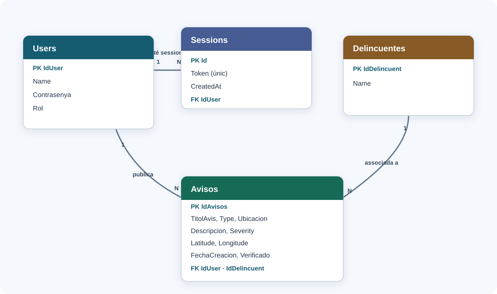

# Disseny, arquitectura i API de NGMo

## 1. Visió general de l’arquitectura

NGMo segueix una arquitectura web de client i servidor:

```text
Navegador
  ├─ Interfície: index.html + styles.css + dist/app.js (compilat de src/app.ts)
  ├─ Mapa: Leaflet + capes de mapa d’OpenStreetMap
  └─ Peticions HTTP/JSON
       ↓
API: ASP.NET Core (.NET 11) — http://localhost:5180/api
       ↓ Entity Framework Core
Base de dades SQLite: backend/ngmo.db
```

- **Frontend:** HTML, CSS i TypeScript. `npm run build` compila `src/app.ts` cap a `dist/app.js`; `npm run dev` serveix els fitxers estàtics.
- **Mapa:** la interfície utilitza Leaflet i les capes d’OpenStreetMap. Aquests recursos es carreguen des d’Internet.
- **Backend:** API REST implementada amb ASP.NET Core i controladors a `backend/Controllers`. Entity Framework Core gestiona l’accés a SQLite.
- **Dades inicials:** quan s’inicia el backend, crea l’esquema si cal, aplica una actualització compatible de l’esquema existent i insereix usuaris, persones i avisos de demostració si les taules són buides.
- **Comunicació:** el frontend envia i rep JSON mitjançant `fetch`, amb credencials de galeta incloses. L’adreça base de l’API està fixada a `http://localhost:5180/api` a `src/app.ts`.

Per iniciar el frontend i l’API localment, consulteu [la guia d’instal·lació](./04-instalacion.md). El perfil HTTP del backend utilitza el port `5238` per defecte, diferent del `5180` configurat al frontend; cal iniciar-lo al port `5180` o canviar l’adreça base del frontend.

## 2. Diagrama entitat-relació

El diagrama següent representa les entitats persistides al backend i les relacions configurades a Entity Framework Core.



### Entitats i relacions

| Entitat | Propòsit |
|---|---|
| **Users** | Comptes d’usuari, amb nom, contrasenya i rol. |
| **Sessions** | Sessions d’autenticació associades a un usuari i identificades per un token únic. |
| **Avisos** | Incidents publicats: títol, tipus, descripció, ubicació, coordenades, gravetat, data i estat de verificació. |
| **Delincuentes** | Persones associades als avisos, representades per un nom. |

- Un **usuari** pot tenir zero o moltes **sessions**; cada sessió pertany a un únic usuari. En eliminar l’usuari, les sessions associades s’eliminen en cascada.
- Un **usuari** pot publicar zero o molts **avisos**; cada avís té un únic usuari autor. No es permet eliminar un usuari que encara tingui avisos associats.
- Una **persona** pot estar associada a zero o molts **avisos**; cada avís referencia una persona. No es permet eliminar una persona mentre hi hagi avisos que la referenciïn.
- Les claus primàries són `IdUser`, `Id`, `IdAvisos` i `IdDelincuent`, respectivament. Les claus foranes són `Sessions.IdUser`, `Avisos.IdUser` i `Avisos.IdDelincuent`.

> Aquest model correspon a la base de dades del backend. La interfície no guarda les dades d’aplicació a `localStorage`; el backend les persisteix a SQLite.

## 3. API REST

L’API està implementada a `backend/` i utilitza JSON. En desenvolupament, el frontend espera l’API a `http://localhost:5180/api`. El backend admet CORS des dels orígens `http://localhost:3000` i `http://127.0.0.1:3000`.

### Endpoints utilitzats pel frontend

| Mètode | Ruta | Funció |
|---|---|---|
| `GET` | `/api/avisos` | Carrega els avisos i les dades associades d’usuari i persona. |
| `GET` | `/api/session` | Recupera l’usuari de la sessió actual mitjançant la galeta `ngmo-session`. |
| `POST` | `/api/login` | Inicia sessió amb `name` i `contrasenya`. |
| `POST` | `/api/register` | Registra un usuari i inicia la seva sessió. |
| `DELETE` | `/api/session` | Tanca la sessió actual. |
| `POST` | `/api/avisos` | Crea un avís amb títol, tipus, ubicació, descripció, coordenades, gravetat i identificadors d’usuari i persona. |
| `PATCH` | `/api/avisos/{id}/verify` | Marca un avís com a verificat. |
| `PUT` | `/api/avisos/{id}` | Actualitza les dades d’un avís. |
| `DELETE` | `/api/avisos/{id}` | Elimina un avís. |

### Altres endpoints disponibles al backend

Aquests endpoints estan implementats, però la interfície actual no els crida:

| Mètode | Ruta | Funció |
|---|---|---|
| `GET` | `/api/avisos/{id}` | Consulta un avís per identificador. |
| `GET` | `/api/users/active` | Retorna usuaris que no tenen el rol de policia i el nombre d’avisos. |
| `GET` | `/api/delincuentes` | Llista les persones associades als avisos. |
| `POST` | `/api/delincuentes` | Crea una persona associada als avisos. |

Durant el desenvolupament, l’API exposa l’especificació OpenAPI a `/openapi/v1.json`.

## 4. Sessions i rols

En iniciar sessió o registrar-se, el backend desa una sessió a SQLite i envia la galeta `ngmo-session` amb l’opció `HttpOnly`. El frontend inclou les credencials a les peticions amb `credentials: "include"`. Els rols `admin` i `policia` controlen la presentació dels panells i les accions disponibles a la interfície.

La comprovació dels rols a la interfície serveix per controlar l’experiència d’usuari; no s’ha de considerar un mecanisme de protecció de l’API. Els endpoints de gestió d’avisos actuals no declaren polítiques d’autorització al servidor.

En aquesta versió de demostració, les contrasenyes es desen i es comparen com a text sense xifrar. No reutilitzeu contrasenyes personals ni desplegueu el sistema en producció sense afegir emmagatzematge segur de credencials i autorització al servidor.

## 5. Persistència i dades de demostració

La cadena de connexió del backend és `Data Source=ngmo.db`; en executar `dotnet run` des de `backend/`, el fitxer de base de dades es crea habitualment com `backend/ngmo.db`. Les dades de demostració inclouen els comptes `admin` i `policia` amb la contrasenya `1234`; canvieu o elimineu aquestes credencials abans d’utilitzar l’aplicació fora d’un entorn de demostració.

Els avisos, usuaris, sessions i persones són persistits al backend. Les preferències temporals de la interfície, com ara l’estat de la pàgina, es mantenen al navegador durant l’execució.
