# Documentació de proves de NGMo

Aquest document recull les proves manuals realitzades sobre la pàgina web **NGMo**. Les comprovacions validen que les accions principals funcionen des del navegador i que l’aplicació mostra els missatges, els estats i els resultats esperats.

> **Tipus de prova:** funcional i manual  
> **Entorn:** navegador web amb persistència local  
> **Resultat general:** les funcionalitats documentades han superat les comprovacions realitzades

---

## Índex de proves

| Nº | Prova | Resultat |
|---|---|---|
| 1 | Inici i registre de sessió | ✅ Superada |
| 2 | Generació d’un avís | ✅ Superada |
| 3 | Validació del formulari | ✅ Superada |
| 4 | Modificació i eliminació d’avisos | ✅ Superada |
| 5 | Certificació policial | ✅ Superada |
| 6 | Filtres per categoria | ✅ Superada |
| 7 | Consulta dels avisos personals | ✅ Superada |
| 8 | Actualització dels rànquings | ✅ Superada |

---

## 1. Inici i registre de sessió

### 1.1. Accés al formulari

**Objectiu:** Comprovar que la pàgina permet obrir el formulari d’inici de sessió i distingir entre usuari registrat i nou usuari.

**Passos:**

1. Accedir a la pàgina principal de NGMo.
2. Premer el botó circular de l’usuari.
3. Revisar els camps **Usuari** i **Contrasenya**.
4. Comprovar que existeixen les opcions **Iniciar sessió** i **Crear un compte**.

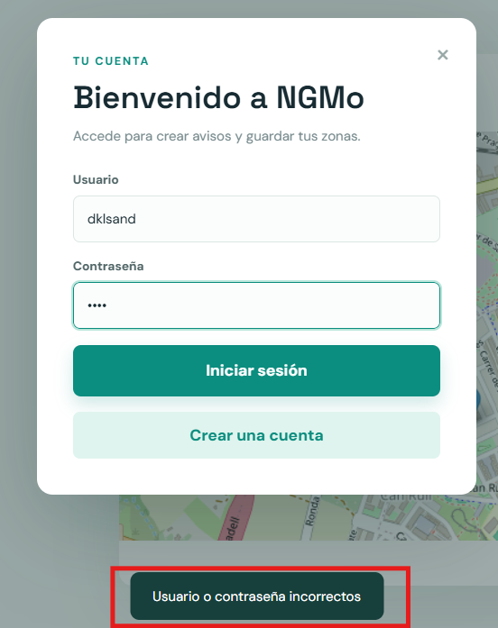

**Comportament observat:** El formulari s’obre correctament en una finestra modal sobre el mapa. També mostra les opcions de sessió i registre.

### 1.2. Credencials incorrectes

**Objectiu:** Verificar que l’aplicació no permet l’accés amb dades incorrectes.

**Acció:** Introduir un usuari o una contrasenya no vàlids i prémer **Iniciar sessió**.

**Resultat:** Apareix el missatge **«Usuari o contrasenya incorrectes»** i la sessió no s’inicia.

**Prova superada:** ✔️

### 1.3. Inici de sessió correcte

**Objectiu:** Comprovar que una sessió vàlida identifica l’usuari i permet accedir a la pàgina principal.

**Acció:** Iniciar sessió amb les dades autoritzades i tornar a la pàgina principal.

**Resultat:** La barra superior mostra la inicial de la sessió activa, apareix el botó **Tancar sessió** i es confirma l’inici correcte amb un missatge.

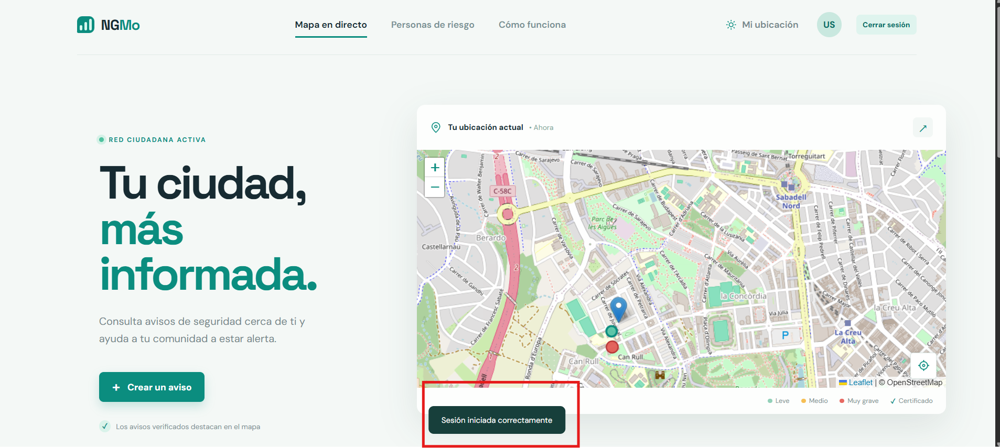

**Prova superada:** ✔️

---

## 2. Generació d’un avís

### 2.1. Selecció del tipus i obertura del formulari

**Objectiu:** Comprovar que un usuari amb sessió iniciada pot obrir i completar el formulari de nou avís.

**Passos:**

1. Premer **Crear un avís**.
2. Seleccionar una categoria a **Tipus d’incident**.
3. Revisar que el formulari mostra el camp d’ubicació i la descripció.

**Categoria seleccionada en la prova:** `Agressió`.

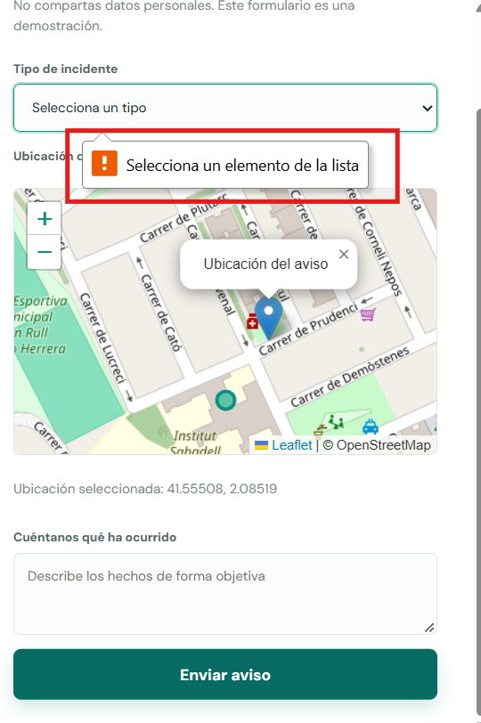

**Comportament observat:** S’obre el formulari nou avís i permet triar el tipus d’incident sense necessitat de recarregar la pàgina.

### 2.2. Selecció de la ubicació

**Objectiu:** Validar que l’usuari pot escollir un punt del mapa i que les coordenades es mostren al formulari.

**Passos:**

1. Obrir el mapa dins del formulari.
2. Fer clic sobre la ubicació on hauria passat l’incident.
3. Comprovar que apareix el text amb les coordenades seleccionades.

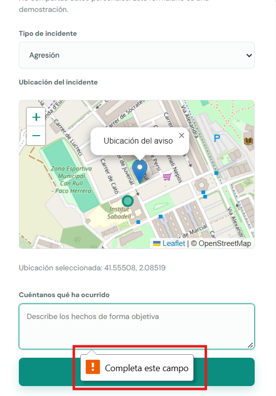

**Comportament observat:** La ubicació seleccionada queda visible i el formulari mostra les coordenades corresponents.

### 2.3. Publicació de l’avís

**Objectiu:** Comprovar que un avís complet es desa i apareix al mapa i a la llista.

**Passos:**

1. Completar els camps obligatoris.
2. Escriure una descripció objectiva.
3. Premer **Enviar avís**.

**Resultat:** Apareix el missatge **«Avís publicat i afegit al mapa»**. El nou avís queda marcat en la ubicació seleccionada i es mostra a la interfície.

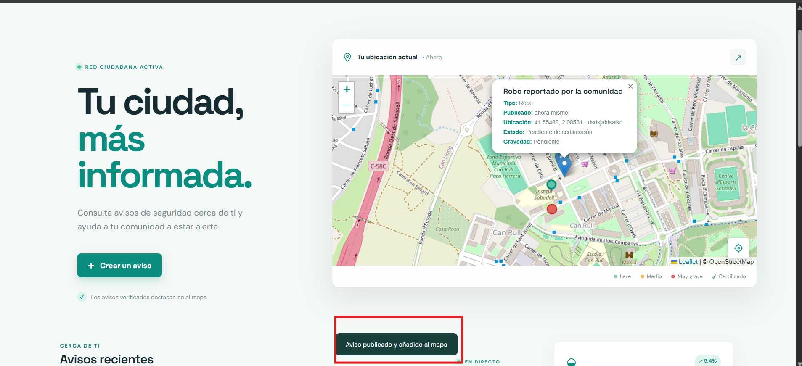

**Prova superada:** ✔️

---

## 3. Validació del formulari d’avís

### Objectiu

Comprovar que no es pot enviar un avís quan falta un camp obligatori.

### Passos

1. Obrir el formulari de publicació.
2. Completar només una part dels camps.
3. Premer **Enviar avís** sense omplir la descripció.

### Resultat

El navegador impedeix l’enviament i mostra un avís indicant que el camp obligatori encara no s’ha completat.

**Prova superada:** ✔️

---

## 4. Modificació i eliminació d’avisos

### 4.1. Modificació des del panell d’administració

**Objectiu:** Comprovar que l’administrador pot obrir les opcions d’un avís i desar els seus canvis.

**Passos:**

1. Iniciar sessió amb el compte d’administració autoritzat.
2. Obrir el panell **Administració**.
3. Premer el menú amb tres punts de l’avís.
4. Seleccionar **Modificar**.
5. Canviar les dades necessàries i desar el formulari.

**Resultat:** Apareix el missatge **«Avís actualitzat»** i les noves dades es reflecteixen al llistat.

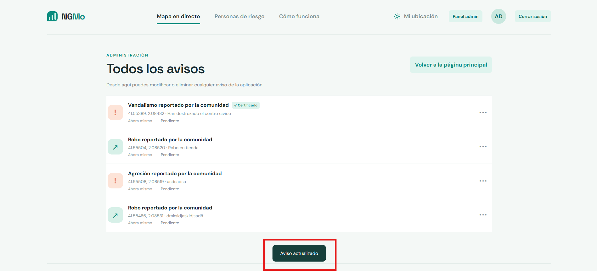

### 4.2. Eliminació d’un avís

**Objectiu:** Verificar que l’administrador pot eliminar un avís després de confirmar l’acció.

**Passos:**

1. Obrir el menú d’opcions d’un avís.
2. Seleccionar **Eliminar**.
3. Confirmar l’eliminació al diàleg del navegador.

**Resultat:** L’avís desapareix del llistat i l’aplicació mostra el missatge **«Avís eliminat»**.

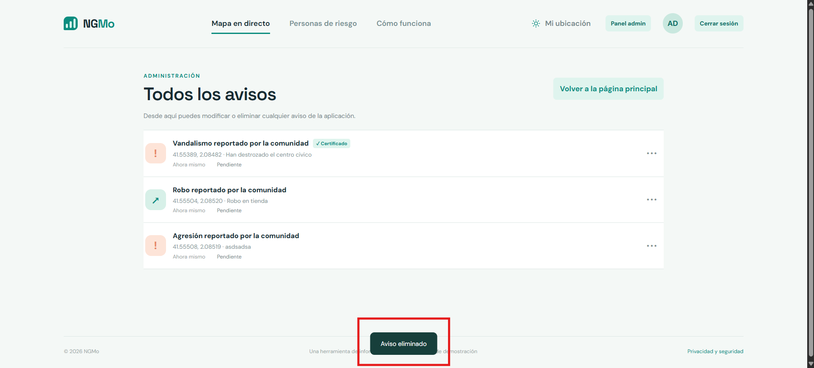

**Proves superades:** ✔️ ✔️

---

## 5. Certificació policial

### Objectiu

Comprovar que un avís pendent pot ser certificat pel compte policial i que el canvi es mostra a tota l’aplicació.

### Passos

1. Iniciar sessió amb el compte policial autoritzat.
2. Obrir el panell **Gestió policial**.
3. Comprovar l’avís pendent i la distància indicada.
4. Premer **Certificar**.

### Resultat

L’avís deixa d’aparèixer com a pendent i passa a mostrar la marca **✓ Certificat**. La certificació també fa que es representa en vermell al mapa.

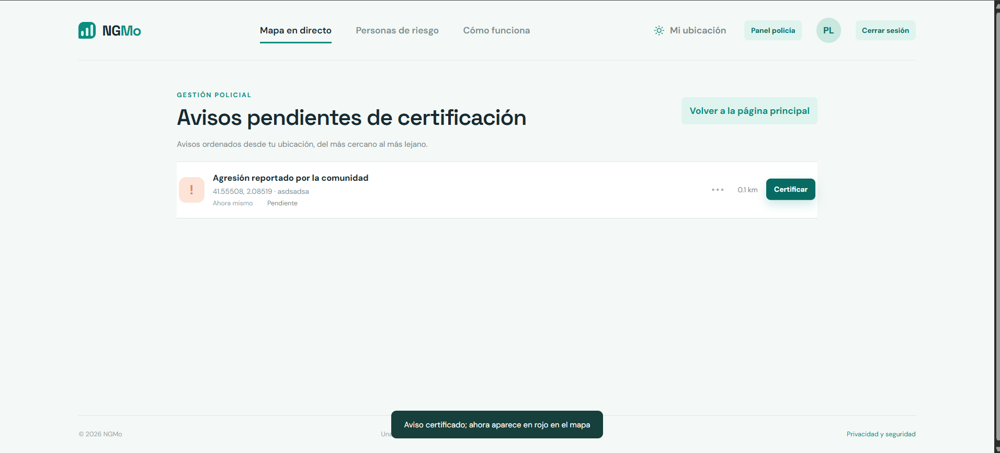

La confirmació mostra el missatge **«Avís certificat, ara apareix en vermell al mapa»**.

**Prova superada:** ✔️

---

## 6. Filtre per categories

### Objectiu

Comprovar que els filtres permeten mostrar només els avisos que pertanyen a una categoria determinada.

### Passos

1. Entrar a la secció **Avisos recents**.
2. Seleccionar el filtre **Robatori**.
3. Comprovar que només es mostra el nombre i els avisos corresponents.
4. Tornar a seleccionar **Tots**.

### Resultat

El filtre seleccionat queda ressaltat i els avisos que no pertanyen a la categoria desapareixen temporalment de la llista.

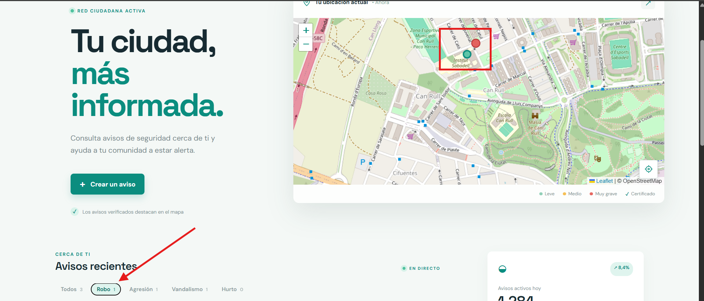

**Prova superada:** ✔️

---

## 7. Consulta dels avisos personals

### Objectiu

Comprovar que un usuari pot consultar els avisos que ha publicat des de la seva activitat.

### Passos

1. Iniciar sessió com a usuari.
2. Desplaçar-se a la secció **La seva activitat**.
3. Comprovar la categoria, la ubicació i l’estat de cada avís.

### Resultat

La secció **Mis avisos** mostra els avisos creats per la sessió activa. Cada registre indica el tipus, la ubicació aproximada i si està pendent o certificat.

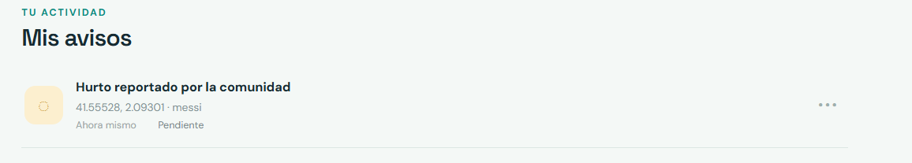

**Prova superada:** ✔️

---

## 8. Rànquings i activitat de la comunitat

### Objectiu

Comprovar que els rànquings es construeixen a partir dels avisos registrats i que els canvis a la comunitat s’actualitzen.

### Passos

1. Crear un o diversos avisos amb usuaris diferents.
2. Tornar a la pàgina principal.
3. Revisar el rànquing **Usuaris més actius**.
4. Comprovar que cada usuari apareix ordenat segons els seus avisos.

### Resultat

El rànquing mostra els usuaris amb més avisos i indica el nombre total associat a cada registre.

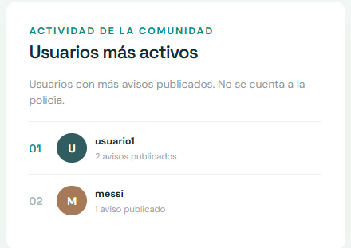

**Prova superada:** ✔️

---

## Conclusions

Les proves manuals confirmen el funcionament dels fluxos principals de NGMo:

- ✅ Els usuaris poden iniciar i tancar una sessió.
- ✅ Es valida l’accés amb dades incorrectes.
- ✅ Es poden crear avisos, seleccionar-ne la ubicació i publicar-los.
- ✅ El formulari impedeix enviaments incomplets.
- ✅ Els administradors poden modificar i eliminar avisos.
- ✅ La policia pot certificar avisos pendents.
- ✅ Els avisos es poden filtrar per categoria.
- ✅ Els avisos personals i els rànquings reflecteixen l’activitat registrada.

Les dades utilitzades són de demostració i l’aplicació emmagatzema la seva informació al navegador mitjançant persistència local.
